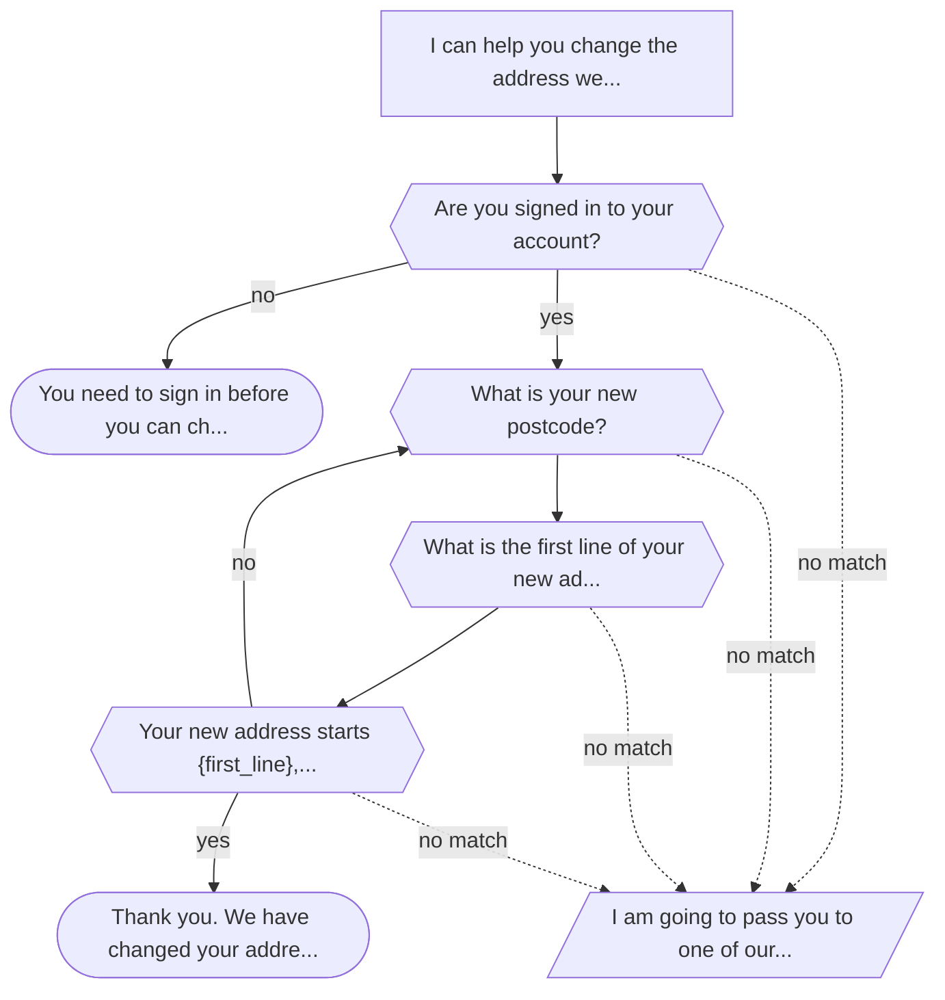

# flow-lint

Find the dead ends in a chatbot flow before a user does.

You write a dialogue flow as a plain text file. The tool checks it for mistakes, lets you walk through it with test answers and draws it as a diagram.

## The problem it solves

Scripted flows are still the safest choice for tasks that must go the same way every time, like changing an address or taking a payment. They also break in the same few ways:

- a step that leads nowhere
- a question with no plan for an answer the bot does not understand
- a retry that loops forever
- no way to reach a person

These are easy to miss in a diagram tool and expensive to find in live chats. This tool finds them in seconds. It can run on every change, so a broken flow cannot be released.

## Try it

You need Python 3.10 or later.

```bash
git clone https://github.com/Welchlea/flow-lint.git
cd flow-lint
pip install -e ".[dev]"
```

### Check a flow

```bash
flow-lint check examples/broken_flow.yaml
```

```text
error   E008  [welcome] Trap: no ending can be reached from this step
error   E003  [ask_signed_in] 'no' points to 'sign_in_help', which does not exist
error   E005  [ask_signed_in] The question has no 'no_match' reply for unclear answers
error   E008  [ask_signed_in] Trap: no ending can be reached from this step
error   E006  [ask_postcode] 'no_match' has no 'then' step, so the user can be asked again forever
error   E008  [ask_postcode] Trap: no ending can be reached from this step
error   E008  [confirm] Trap: no ending can be reached from this step
error   E004  [saved] Dead end: the conversation stops here with no ending
error   E007  [saved] No path leads to this step
error   E007  [old_survey] No path leads to this step
warning W005  No handover step can be reached, so users cannot get to a person
warning W003  [ask_signed_in] The step asks more than one question
warning W004  [ask_postcode] Free text question with no 'pattern', so any answer is accepted

update-address-draft: 6 steps, 10 errors, 3 warnings
```

The command exits with an error when it finds errors. Add `--strict` to fail on warnings too.

### Walk through a flow

Give one `--say` for each answer the user gives.

```bash
flow-lint run examples/update_address.yaml --say yes --say "my postcode" --say "SR2 7AB" --say "12 High Street" --say yes
```

```text
BOT   I can help you change the address we hold for you.
BOT   Are you signed in to your account?
USER  yes
BOT   What is your new postcode?
USER  my postcode
BOT   That does not look like a UK postcode. It should look like SR2 7AB. What is your new postcode?
USER  SR2 7AB
BOT   What is the first line of your new address?
USER  12 High Street
BOT   Your new address starts 12 High Street, SR2 7AB. Is that right?
USER  yes
BOT   Thank you. We have changed your address. We will send a letter to your new address to confirm.
[completed]
```

Two unclear answers in a row go to a person:

```bash
flow-lint run examples/update_address.yaml --say maybe --say what
```

```text
BOT   I can help you change the address we hold for you.
BOT   Are you signed in to your account?
USER  maybe
BOT   Sorry, I need a yes or no. Are you signed in to your account?
USER  what
BOT   I am going to pass you to one of our team so they can help. You will not need to repeat what you have told me.
[handover]
```

### Draw a flow

```bash
flow-lint diagram examples/update_address.yaml
```

This prints Mermaid code. GitHub turns it into a picture. This is the example flow:



## What it checks

| Code | Level | Problem |
| --- | --- | --- |
| E001 | Error | The flow has no starting step, or the start does not exist. |
| E002 | Error | A step has an unknown type. |
| E003 | Error | A link points to a step that does not exist. |
| E004 | Error | Dead end. A step is not an ending and leads nowhere. |
| E005 | Error | A question has no reply for answers it does not understand. |
| E006 | Error | A retry has no way out, so the user can be asked again forever. |
| E007 | Error | No path leads to a step. |
| E008 | Error | Trap. No ending can be reached from a step. |
| W001 | Warning | A step says nothing. |
| W002 | Warning | A message is longer than 40 words. |
| W003 | Warning | A step asks more than one question. |
| W004 | Warning | A free text question accepts any answer. |
| W005 | Warning | No handover step can be reached. |

## Write a flow

A flow is a list of named steps. There are four types of step.

| Type | What it does |
| --- | --- |
| `message` | Says something, then moves to `next`. |
| `question` | Asks something and waits for an answer. |
| `handover` | Passes the user to a person. The flow ends. |
| `end` | Finishes the task. The flow ends. |

A question with set answers:

```yaml
ask_signed_in:
  type: question
  say: Are you signed in to your account?
  options:
    - match: [yes, yeah, yep, i am]
      next: ask_postcode
    - match: [no, nope, not]
      next: sign_in_first
  no_match:
    say: Sorry, I need a yes or no. Are you signed in to your account?
    max_retries: 1
    then: handover
```

A question with a free text answer. `pattern` says what a good answer looks like. `capture` saves the answer so a later message can repeat it back with `{postcode}`.

```yaml
ask_postcode:
  type: question
  say: What is your new postcode?
  capture: postcode
  pattern: "[A-Z]{1,2}[0-9][0-9A-Z]? ?[0-9][A-Z]{2}"
  next: ask_first_line
  no_match:
    say: That does not look like a UK postcode. It should look like SR2 7AB. What is your new postcode?
    max_retries: 2
    then: handover
```

## Design decisions

- **Unclear answers are part of the design.** A question with no `no_match` is an error, not a warning. Users give unexpected answers every day.
- **Every retry has a limit and a way out.** After the limit, the user goes to a person. They are never stuck.
- **The retry message says more than the first one.** The example postcode retry shows the format. Repeating the same question does not help.
- **The flow repeats details back before saving them.** The user can say no and correct them.
- **Handover is a full step type.** A flow with no route to a person gets a warning.
- **Flows are text files.** They can be reviewed, compared between versions and tested like code.

## Limits

- Answers are matched by keyword or pattern. There is no language model and no intent recognition here.
- The simulator follows one path at a time. It does not try every possible path.
- The postcode pattern checks the shape of a postcode. It does not check the postcode exists.

## Project layout

```text
src/flow_lint/
  model.py      loads a flow and works out how steps connect
  lint.py       the checks
  simulate.py   walks through a flow with scripted answers
  diagram.py    Mermaid diagram output
  cli.py        the command line
examples/       one clean flow and one broken flow
tests/          23 automated tests
```

Run the tests with `pytest`.

## About the example

Brightwater Pensions is made up. No real customer data, client content or company material is used anywhere in this project.

Built with AI pair programming.

## Licence

MIT
